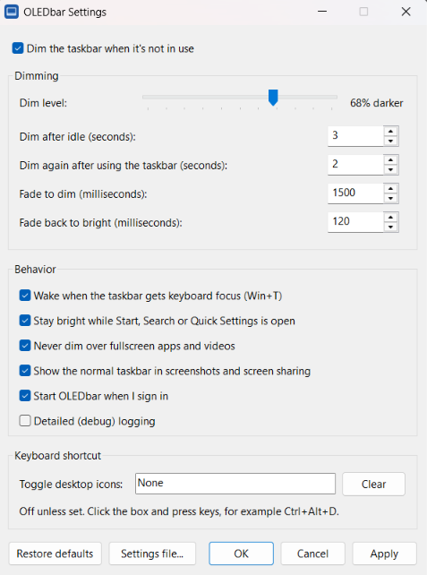

# OLEDbar

[](https://github.com/midimaxi-dev/OLEDbar/actions/workflows/build.yml)

**Helps reduce the risk of OLED taskbar burn-in while keeping the taskbar visible.** [Check OLEDbar Website](https://midimaxi-dev.github.io/OLEDbar/)

After a few seconds without mouse activity on the Windows 11 taskbar, a dark, click-through layer fades in over it, even if the pointer is parked on it. This dims the background, icons, text, clock and tray. Moving onto or within the taskbar, clicking or scrolling wakes it. It stays bright during a drag and, by default, while Start or Search is open.

> **Status:** version 0.3.0, a usable early release.

- **Tiny footprint, not a heavy suite:** a **~685 KB release EXE**, using only **about 1 MB of memory** while idle (as shown in Task Manager). No runtime to install; no admin rights required.
- No injection into Explorer: it only draws a click-through layer above the taskbar.
- Settings panel with a live preview of the dim level on your taskbar.
- By default, hides the overlay for fullscreen apps and when the taskbar is auto-hidden.
- By default, keeps the dimming overlay out of supported screenshots and screen sharing.
- Pauses itself while the PC is locked or the screen is off.
- Optional keyboard shortcut (and tray menu item) to show or hide the desktop icons.

## Who this is for

**OLEDbar is for you if:**

- you use an OLED laptop or monitor on Windows 11
- you don't want taskbar auto-hide
- you want a tiny utility, not a heavy suite
- you care about reducing static UI brightness

## Download and install

Get the latest version from **[Releases](https://github.com/midimaxi-dev/OLEDbar/releases/latest)**. It requires Windows 11 22H2 or later (x64).

| Download | Best for |
|---|---|
| `OLEDbar-<version>-x64-setup.exe` | Most people. Installs for your user only, no admin rights. Adds a Start menu entry, can start OLEDbar when you sign in, and appears in *Settings → Apps* for uninstalling. |
| `OLEDbar-<version>-x64.zip` | Portable use. Unzip anywhere and run `OLEDbar.exe`. Turn on *Start OLEDbar when I sign in* in its settings if you like. |

`SHA256SUMS.txt` lists checksums for both files. To verify a download, compare its hash with the matching entry, for example: `Get-FileHash .\OLEDbar-0.3.0-x64-setup.exe`.

Windows may warn about unsigned releases; see [Unsigned releases](#unsigned-releases).

## Settings

Left-click the OLEDbar tray icon to open the settings panel. The icon may be hidden behind the **^** arrow.



Adjust the dim level with a live preview, change delays and fade durations, or choose behavior options. You can also start OLEDbar when you sign in and set a keyboard shortcut to toggle desktop icons (off by default; for example, Ctrl+Alt+D).

Press **OK** or **Apply** to save; **Restore defaults** resets the controls. For advanced configuration, see [Settings file](#settings-file).

## FAQ

- **Does it work with auto-hide?** Yes. The overlay hides while the taskbar is hidden and can resume when it reappears.
- **Are clicks and scrolling always detected?** Normally yes, through mouse Raw Input. If registration fails, OLEDbar falls back to polling: movement and held buttons on the taskbar still wake it, but stationary scrolling and brief clicks between polls may be missed. HID-only touchpad, touch or pen activity without cursor movement may also be missed; moving the pointer on the taskbar wakes it.
- **Does it affect fullscreen apps?** By default, OLEDbar hides its overlay when it detects a fullscreen app or video.
- **Does it show up in screenshots?** Normally not. By default, OLEDbar asks Windows to exclude the dimming overlay from screenshots and screen sharing; you can change this in Settings.
- **Does it support multi-monitor?** Yes, but only the primary display's taskbar is dimmed. Additional taskbars are not dimmed yet.
- **Does it require admin rights?** No. Both the per-user installer and the portable app run without administrator rights.
- **Is it signed?** Current releases are unsigned. Windows may warn or block them; if Smart App Control blocks OLEDbar, wait for a signed release.
- **Does it send data anywhere?** No. OLEDbar makes no network connections; settings and logs are stored locally in `%LOCALAPPDATA%\OLEDbar`.

## Uninstall

- **Installer version:** *Settings → Apps → Installed apps → OLEDbar → Uninstall*. This closes OLEDbar and removes the app, its startup entry, settings and logs.
- **Portable version:** untick *Start OLEDbar when I sign in* in its settings, choose **Exit** from the tray menu, and delete the folder. Settings and logs are in `%LOCALAPPDATA%\OLEDbar`; delete that folder too.

## Privacy

OLEDbar makes no network connections. It stores settings and logs locally in `%LOCALAPPDATA%\OLEDbar`; the optional *Start when I sign in* entry is stored in your user's registry.

## Building from source

Requirements:
- Windows 11 22H2 or later, x64
- Visual Studio Build Tools 2022 (C++), only needed to build from source

## Setup (one time)

1. **Install the C++ build tools.** Run this from an **elevated** terminal (Win+X → *Terminal (Admin)*). It's about 3–4 GB:

   ```powershell
   winget install --id Microsoft.VisualStudio.2022.BuildTools --override "--wait --nocache --add Microsoft.VisualStudio.Component.VC.Tools.x86.x64 --add Microsoft.VisualStudio.Component.Windows11SDK.26100 --add Microsoft.VisualStudio.Component.VC.CMake.Project --add Microsoft.VisualStudio.Component.Vcpkg"
   ```

   If Build Tools are **already installed**, winget won't add components. Use the Visual Studio Installer instead: *Modify* → *Individual components*, then tick:
   - MSVC v143 x64/x86 build tools
   - Windows 11 SDK (10.0.26100)
   - C++ CMake tools for Windows
   - vcpkg package manager

2. **VS Code extensions:** install *C/C++* (`ms-vscode.cpptools`) and *CMake Tools* (`ms-vscode.cmake-tools`). VS Code offers them when you open the folder.

3. **Check the install.** All four lines should print `True`:

   ```powershell
   $vswhere = "${env:ProgramFiles(x86)}\Microsoft Visual Studio\Installer\vswhere.exe"
   'VC.Tools.x86.x64','Windows11SDK.26100','VC.CMake.Project','Vcpkg' | ForEach-Object {
     "$_ = $([bool](& $vswhere -products * -requires "Microsoft.VisualStudio.Component.$_" -property installationPath))"
   }
   ```

## Build and test

**In VS Code:** select the **x64 Debug** preset in the CMake Tools status bar, then press **F7** to build.

**From a terminal:** load the compiler environment first (once per terminal session), then configure, build and test:

```powershell
& "C:\Program Files (x86)\Microsoft Visual Studio\2022\BuildTools\Common7\Tools\Launch-VsDevShell.ps1" -Arch amd64 -HostArch amd64 -SkipAutomaticLocation
cmake --preset x64-debug          # first run downloads WIL and GoogleTest via vcpkg
cmake --build --preset x64-debug
ctest --preset x64-debug
```

Use the `x64-release` presets for a smaller, optimized build.

## Run

```powershell
.\out\build\x64-debug\OLEDbar.exe
```

Or press **F5** in VS Code to run it under the debugger. For everyday use, build the release preset (`cmake --preset x64-release; cmake --build --preset x64-release`) and run `out\build\x64-release\OLEDbar.exe`. It's a single ~685 KB EXE, and you can copy it anywhere.

Whenever OLEDbar starts, a notification tells you it is running and where to find its tray icon, even if you already have saved settings. Windows notification settings or Do not disturb may hide it.

- Run it from a **normal (non-admin)** terminal. An elevated copy can't be stopped or rebuilt from a normal terminal.
- Only one copy runs at a time; launching it again opens the settings panel of the running copy. **Exit** it from the tray menu before rebuilding, otherwise linking `OLEDbar.exe` fails.

**Tray icon** (it may be hidden behind the **^** arrow): a small screen with a taskbar strip, which looks faded while paused. **Left-click** opens the settings panel; **right-click** opens the menu:

| Item | Purpose |
|---|---|
| Pause ▸ | For 15 minutes, for 1 hour, or until you resume. Shows **Resume** while paused |
| Dim now | Dim immediately (useful for testing) |
| Toggle desktop icons | Show or hide the desktop icons, like the desktop's *View → Show desktop icons*. Shows your shortcut, if set |
| Settings... | Open the settings panel |
| Open log | Open `%LOCALAPPDATA%\OLEDbar\logs\oledbar.log` (state changes, taskbar, fullscreen, session and settings events) |
| Exit | Quit |

## Settings file

The same settings are stored in `%LOCALAPPDATA%\OLEDbar\settings.json` (the panel's **Settings file...** button opens it). If you edit and save the file directly, the changes apply immediately, with no restart. If something is wrong, a notification appears and the details go to the log.

| Key | Default | Meaning |
|---|---|---|
| `enabled` | `true` | `false` turns dimming off until you set it back |
| `idleTimeoutSeconds` | `10` | Delay before dimming while the pointer is stationary on the taskbar, at startup, and after a pause or fullscreen app (1–3600) |
| `redimDelaySeconds` | `3` | Delay before dimming after the pointer leaves the taskbar or Start/Search closes with the pointer elsewhere (0–3600) |
| `dimLevelPercent` | `70` | How much light to remove: 0 = none, 100 = black |
| `fadeToDimMs` | `1500` | Fade-out duration (0–5000) |
| `fadeToWakeMs` | `120` | Fade-in duration on taskbar activity or another wake signal (0–5000) |
| `wakeOnTaskbarFocus` | `true` | Wake when the taskbar gets keyboard focus (Win+T, clicking it) |
| `wakeOnShellUi` | `true` | Stay bright while Start, Search or Quick Settings is open |
| `hideInFullscreen` | `true` | Hide the overlay when a fullscreen app or video is detected |
| `excludeFromCapture` | `true` | Exclude the overlay from supported screenshots and screen sharing |
| `logLevel` | `"info"` | `"debug"` also logs every foreground-window change and hover, for troubleshooting |
| `toggleDesktopIconsHotkey` | `""` | Global shortcut that shows/hides desktop icons, e.g. `"Ctrl+Alt+D"`. Needs Ctrl or Alt; `""` turns it off. Works even while dimming is paused or disabled |

If the shortcut is already taken by another app, OLEDbar tells you and leaves it unassigned; pick a different one.

Invalid JSON is reported and ignored: OLEDbar keeps the previous settings (defaults at startup) and doesn't touch your file. `//` comments are allowed, but saving from the settings panel rewrites the file without them.

**Start OLEDbar when I sign in** is stored in the registry (`HKCU\...\CurrentVersion\Run`), not in the JSON file. It respects the toggle in Task Manager → *Startup apps*. If you move the EXE, the entry is updated the next time you start it.

## Packaging and releases

**Local packages:** after a release build, run:

```powershell
.\packaging\package.ps1
```

This writes `OLEDbar-<version>-x64.zip`, `SHA256SUMS.txt` and, if [Inno Setup 6](https://jrsoftware.org/isinfo.php) is installed (`winget install JRSoftware.InnoSetup`), `OLEDbar-<version>-x64-setup.exe` to `out\dist`. The installer is defined in `packaging/installer/oledbar.iss`.

**CI:** GitHub Actions ([.github/workflows/build.yml](.github/workflows/build.yml)) builds, tests and packages every push and pull request. The zip and installer are attached to each run as artifacts.

**Releasing a version:**
1. Bump `project(... VERSION x.y.z)` in `CMakeLists.txt` and commit. This is the only place the version is set.
2. Tag and push:
   ```powershell
   git tag v0.3.0; git push origin v0.3.0
   ```
3. The workflow checks that the tag matches the project version, builds, and creates a **draft** GitHub Release with the installer, zip and checksums. Review it on GitHub, then click **Publish**.

## Known limitations

- **Multiple monitors:** only the main taskbar (the one on your primary display) is dimmed. Extra taskbars shown with *Settings → Personalization → Taskbar → Show my taskbar on all displays* are not dimmed yet.

## Troubleshooting

- **Builds or tests are slow the first time:** Windows security software may scan newly built executables on their first launch. Later runs are usually faster.
- **`winget` says "No available upgrade found":** Build Tools are already installed. Add the missing components with the Visual Studio Installer (see Setup).
- **The installer exits with code 5007:** a `--passive` install was run from a non-elevated terminal. Use an admin terminal, or drop `--passive` so the installer can ask for elevation itself.

## Project layout

```
src/core/        Pure C++: dimming state machine, settings and shortcut parsing (no Windows headers, unit tested)
src/platform/    Win32: overlay window, taskbar locator, input and shell events, settings file, run at startup, desktop icons, logging
src/app/         WinMain, tray icon, settings panel (dialog + .rc), wiring (AppHost), manifest
tests/           GoogleTest unit tests
packaging/       package.ps1 (zip + installer) and installer/oledbar.iss (Inno Setup)
.github/         GitHub Actions workflow (build, test, package, draft release on tags)
```

## Code signing policy

### Unsigned releases

Releases are currently unsigned. Free code signing through the SignPath Foundation has been requested; once granted, this section will carry their attribution.

- Signed files are built by GitHub Actions from this repository's source code ([.github/workflows/build.yml](.github/workflows/build.yml)). Nothing built locally is signed.
- Committers and reviewers: [midimaxi-dev](https://github.com/midimaxi-dev)
- Approvers (who approve each release for signing): [midimaxi-dev](https://github.com/midimaxi-dev)
- All team members use multi-factor authentication for GitHub and SignPath.

## License

[MIT](LICENSE)
